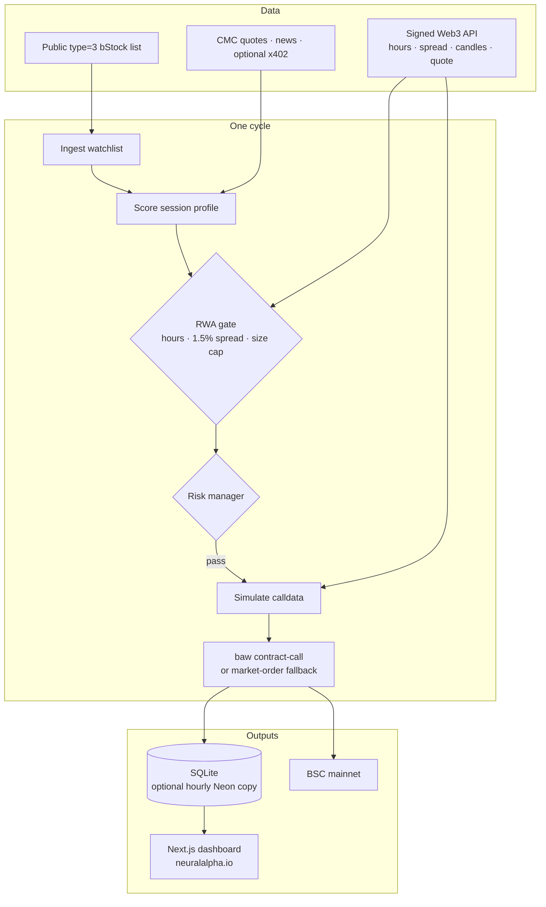

<p align="center">
  <strong>N E U R A L &nbsp; A L P H A</strong>
</p>

<p align="center">
  Autonomous spot agent for tokenized US stocks (bStock) on BNB Smart Chain.
  It scores the book, checks hours and spread, and sends swaps through Binance Agentic Wallet.
</p>

<p align="center">
  <a href="https://neuralalpha.io">Live site</a> &middot;
  <a href="https://neuralalpha.io/about">About</a> &middot;
  <a href="https://github.com/ClipXonchain/neural-alpha">Repository</a>
</p>

<p align="center">
  
  
  
  
  
</p>

| | |
|---|---|
| Repository | https://github.com/ClipXonchain/neural-alpha |
| Public site | https://neuralalpha.io |
| Also public | https://agents.clipx.app |
| Chain | BNB Smart Chain, chainId `56`. Spot only. |

---

## What it is

Neural Alpha is a trading desk for **Binance bStocks**: tokenized US stocks whose symbols end in `B` (NVDAB, AAPLB, TSLAB, and the rest of the type=3 universe). It does not trade perps, Ondo (`…on`), or xStocks (`…x`).

Each cycle the agent:

1. Loads the public type=3 bStock list and the current eligible set.
2. Scores names with session-weighted technicals, volume, news, and optional LLM review.
3. Asks the signed Binance Web3 RWA book whether the underlying market is open, paused, or closed, and whether the on-chain price is rich versus the API reference price.
4. Runs the same order through the risk manager (size, confidence, drawdown, cooldowns, allowlist).
5. In live mode, quotes the swap, simulates the calldata, then broadcasts it with Agentic Wallet. Paper mode fills locally and never signs.

Keys stay in Binance Agentic Wallet (MPC). The process does not hold a trading private key. The agent API binds to `127.0.0.1`. The public dashboard is read-only.

The same codebase still records FIFO realized PnL and the paid x402 calls from the [bStock AI-Powered PnL Contest](https://web3.binance.com/en/dev-docs/products/agentic-wallet/use-cases/campaigns/bstock-pnl-contest) (17 Aug – 1 Sep 2026 UTC).

---

## Architecture



| Step | What the code does |
|---|---|
| Universe | `integrations/bstock.ts` reads the public type=3 list. Eligibility is `ELIGIBLE_BSTOCKS`, else `neural-alpha/data/eligible-bstocks.json`, else the non-leveraged type=3 set. |
| Score | `strategy/signals.ts` plus the active session profile in `strategy/presets.ts`. |
| Hours and spread | `strategy/rwa-book.ts`. A missing or `pause` status blocks the order. A buy is blocked when on-chain price is at least 1.5% rich versus `referencePrice`. `referencePrice` is the API's per-share conversion, not an NYSE print. |
| Closed market | Buys while status is `closed` or `overnight` are capped. Default band is $8–$15 (`HACKATHON_MAX_TRADE_USD`). Stale research uses the $8 floor. One new closed-market name at a time. |
| Send | `execution/hackathon-route.ts` quotes and builds calldata on the Trading API, simulates on the Transaction API, then broadcasts. A failed simulation never falls through to a send. |
| Fallback | `baw market-order swap` runs only when Developer Mode is off, or the route is RFQ and returned no EVM calldata. |
| Research | Optional `STUDIO_AGENT_URL`. If unset, closed-market research can use `https://stock-agent.bnbchain.org/x402/analyze/async`. That wallet does not hold the bStock inventory. |

Operator path: browser → https://neuralalpha.io → Next.js → agent API on `127.0.0.1`. Public builds set `READONLY` and `NEXT_PUBLIC_READONLY`, so visitors can watch state and cannot start, stop, or trade.

---

## Prerequisites

| Requirement | Why |
|---|---|
| Node.js 20+ | ESM agent and Next.js 15 dashboard |
| npm 9+ | Workspaces: `neural-alpha`, `dashboard` |
| [Binance Agentic Wallet CLI](https://web3.binance.com/en/dev-docs/products/agentic-wallet/introduction) | Sign-in, balances, `market-order`, `contract-call`, x402 |
| BSC gas (BNB) | Live sends. Keep a reserve; default `MIN_GAS_RESERVE_USD` is 1.5 |
| Payment token | Buys spend one of BNB, USDT, USDC, U, USD1. Default `PAYMENT_TOKEN=USDT` |
| Web3 API key | Signed RWA, Market, Trading, Transaction, Wallet, and DeFi reads. Create a project at the [developer portal](https://web3.binance.com/en/dev-portal) |

```bash
npm i -g @binance/agentic-wallet
baw --version
baw auth signin          # confirm in the Binance App
baw wallet status --json
```

A Web3 API key does not sign the CLI in. Agentic Wallet is a separate session (`~/.baw`). Developer Mode, turned on in the Binance app, is what lets `baw contract-call` broadcast the simulated calldata.

---

## Quick start

```bash
git clone -b hackathon https://github.com/ClipXonchain/neural-alpha.git
cd neural-alpha
npm install
cp .env.example .env
```

Minimum local paper run. Paper mode simulates fills. It does not broadcast.

```bash
# .env
AGENT_MODE=paper
BRIDGE_MODE=auto
PAYMENT_TOKEN=USDT
```

```bash
npm run dev
```

| Service | URL |
|---|---|
| Dashboard | http://localhost:3000 |
| Agent API | http://127.0.0.1:3847/api/health |
| About | http://localhost:3000/about |

The header shows **LIVE** when the dashboard is attached to the agent, and **DEMO** when it is not.

Confirm the signed Web3 calls without sending a swap:

```bash
npm run hackathon:check --workspace=neural-alpha
```

That command needs `OC_API_KEY` and `OC_SECRET_KEY` in `.env` before the signed calls can pass. It never broadcasts.

Live mode (`AGENT_MODE=live`) quotes and can send real BSC swaps. Fund the Agentic Wallet with a small amount, sign in, and turn Developer Mode on before you expect a `contract-call` fill.

---

## Configuration

Copy `.env.example`. Do not commit `.env`.

### Modes

| | `AGENT_MODE=paper` | `AGENT_MODE=live` |
|---|---|---|
| Swaps | Simulated | BSC, via the route in `hackathon-route.ts` |
| Cycle | 30s | 5 min (`TRADE_INTERVAL_MS`, default `300000`) |
| Quote pulse | 10s | 10s (`SIGNAL_REFRESH_MS`) |
| Protective exits | On, checked every 10s | Same |
| Portfolio | Local | Reconciled with the wallet each cycle |

`BRIDGE_MODE` is `auto` (default), `baw`, `cmc-pro`, or `mock`. `auto` uses Agentic Wallet when `baw` is signed in.

### Variables that change behavior

| Variable | Default | Role |
|---|---|---|
| `AGENT_MODE` | `paper` | `paper` or `live` |
| `PAYMENT_TOKEN` | `USDT` | Buy-side token: `BNB`, `USDT`, `USDC`, `U`, `USD1` |
| `BAW_CLI` | `baw` | CLI binary |
| `BINANCE_CHAIN_ID` | `56` | BSC |
| `OC_API_KEY` / `OC_SECRET_KEY` | unset | Signed Web3 API. The signed path includes `/build`. Omitting it returns `40102` |
| `HACKATHON_MAX_TRADE_USD` | `15` | Ceiling for a closed-market autonomous buy |
| `STUDIO_AGENT_URL` | unset | Optional Agent Studio research task. It sizes; it does not custody bStocks |
| `SESSION_POLICY` | `auto` | `auto`, `rth`, `close`, `overnight`. Legacy `safe` / `medium` / `momentum` map to `overnight` / `auto` / `rth` |
| `INITIAL_DEPOSIT_USD` | `2000` | Deposit baseline. Total PnL is NAV minus this deposit plus BNB locked at the first sync |
| `MAX_POSITION_SIZE_USD` | `250` | Cap on a buy. A larger position can still be sold in full |
| `MAX_PORTFOLIO_TOKENS` | session | RTH/close 4, overnight 3, unless overridden |
| `MIN_TRADE_AMOUNT_USD` | `5` | Dust floor |
| `MIN_BUY_CONFIDENCE` | session | About 0.48–0.52 unless overridden |
| `STOP_LOSS_PCT` | session | Protective stop |
| `TAKE_PROFIT_PCT` | session | Arms the trail. It does not sell at that print |
| `TRAILING_GIVEBACK_PCT` | `1` | After the trail arms, sell on a 1% drop from the hold's peak |
| `AUTO_EXIT_ENABLED` | on | Set `false` to disable autonomous stops |
| `SLIPPAGE_TOLERANCE` | `1` | Percent. Also the gap allowed between the Trading API quote and the `baw` quote |
| `DISABLE_DRAWDOWN_LIMIT` | `true` in `.env.example` | `true` turns the drawdown halt off. Unset it to use the session cap (18–22%) |
| `FAILED_SWAP_COOLDOWN_MS` | `1800000` | 30 min before the same name is retried after a failed swap |
| `MIN_BUY_INTERVAL_MS` | `600000` | 10 min between autonomous buys |
| `ELIGIBLE_BSTOCKS` | file | Comma-separated override of `data/eligible-bstocks.json` |
| `ALLOW_LEVERAGED_BSTOCKS` | off | Leveraged and inverse names stay out of new buys |
| `API_SECRET` | unset | Required in production. Bearer token for every non-GET |
| `OPENAI_API_KEY` | unset | Optional. Rules trade without it |
| `OPENAI_MODEL` | `gpt-4o-mini` | Per-cycle signal note. Any OpenAI-compatible API via `OPENAI_BASE_URL` |
| `AI_SIGNAL_ANALYSIS` | on when a key is set | Can nudge confidence. It cannot place or block an order by itself |
| `SQLITE_PATH` | `data/neural-alpha.sqlite` | Live database |
| `DATABASE_URL` | unset | Optional Neon Postgres. Hourly copy of SQLite |
| `CMC_PRO_API_KEY` | unset | Optional CoinMarketCap Pro quotes and Fear & Greed |
| `DASHBOARD_PORT` | `3847` | Agent API. Production `deploy.sh` uses `3006` |
| `LOG_LEVEL` | `info` | `error` `warn` `trade` `signal` `info` `debug` |

The full template, including x402 cadence and CMC macro cache, is `.env.example`. Dashboard-only flags are in `dashboard/.env.example`.

---

## Strategy

### Session profiles

bStocks trade 24 hours on BSC. The cash market does not. `SESSION_POLICY=auto` follows the New York clock and swaps the profile:

| Clock | Window (America/New_York) | Profile |
|---|---|---|
| `rth` | Weekday 09:30–16:00 | Trend, opening-range breakout, volume. Larger size |
| `close` | Weekday 16:00–20:00 | Hold strength into the cash close |
| `overnight` | Everything else, including weekends | Gaps and news. Smaller size |

`SESSION_POLICY=rth|close|overnight` locks one profile. The RWA `marketStatus` from the signed API still gates the order. The NY clock is only the fallback when that field is empty.

### What gets scored

Weights live on the active profile (`strategy/presets.ts`). Factors: RSI(14), MACD(12/26/9), EMA(12/26), Bollinger(20, 2), momentum, volume versus its 20-bar average, market-cap to volume, news sentiment, StochRSI, VWAP, overnight gap, opening-range breakout, and a regime tag. ClipX news is fetched from `CLIPX_NEWS_URL` (default `https://clipx.app/api/news/feed`).

When `OPENAI_API_KEY` is set, the top signals (`AI_SIGNAL_TOP_N`, default 5) get a short LLM note. A daily review runs after midnight UTC unless `AI_DAILY_REVIEW=false`.

### RWA gate

Pure function in `strategy/rwa-book.ts`. No network of its own. The signed client fills it.

| Condition | Buy | Sell |
|---|---|---|
| Status missing or `pause` | Blocked | Blocked |
| On-chain ≥ 1.5% rich vs reference | Blocked | Allowed only if the wallet already holds it, and size stays inside the cap |
| `closed` or `overnight` | $8–$15, one new name, stale research uses $8 | Existing exit rules |
| `regular` or premarket | Normal size, still inside `MAX_POSITION_SIZE_USD` | Normal |

---

## Risk

Enforced in `neural-alpha/src/risk/manager.ts` and the RWA gate, not in a prompt.

| Rule | Behavior |
|---|---|
| Allowlist | Symbol must be an eligible bStock. Stables and `EXCLUDED_TOKENS` cannot be bought |
| Leveraged names | Skipped unless `ALLOW_LEVERAGED_BSTOCKS=true` |
| Confidence | Below the session minimum, no buy |
| Position count | Session cap, overridable with `MAX_PORTFOLIO_TOKENS` |
| Drawdown | Session cap unless `DISABLE_DRAWDOWN_LIMIT=true` |
| Stop and trail | Autonomous when `AUTO_EXIT_ENABLED` is on (the default) |
| Failed swap | 30 minute cooldown on that symbol |
| Quote disagreement | Trading API output and `baw` output must be inside `SLIPPAGE_TOLERANCE`, unless they diverge by 25% or more (treated as a unit mismatch, not a veto) |
| Simulation | A failed `pre-transaction/simulate` blocks the send |
| Gas | BNB below `MIN_GAS_RESERVE_USD` is not spent as the swap token |

FIFO lots and deposit-baseline PnL are in `neural-alpha/src/risk/portfolio.ts`. Gas is not part of campaign realized PnL.

---

## Dashboard

Next.js 15 app in `dashboard/`. Public production: https://neuralalpha.io. `/about` is a fixed overview and does not repaint from the live book.

| Surface | Role |
|---|---|
| Metric cards | NAV, PnL, drawdown, win rate |
| Equity and allocation | Value over time, mix by token |
| Signal monitor | Indicators and the latest AI note |
| Positions and trades | Open lots, history, BSCScan links on live fills |
| Activity | Log stream |
| Wallet | Address, BNB and payment-token balances |
| Agent controls | Size, interval, slippage, session policy. Hidden on the public read-only build |
| AI desk | Assistant and daily review when an OpenAI-compatible key is set |

The browser talks to `/api/agent/*`. The Next.js route proxies that to the agent. SSE is the live channel. Set both `READONLY=true` and `NEXT_PUBLIC_READONLY=true` on any public build. Leave both unset on a machine where you operate the agent.

---

## API

Agent HTTP API, prefix `/api`. Bound to `127.0.0.1`.

GET is public so a monitor can read state. Every other method returns 401 unless `Authorization: Bearer <API_SECRET>` matches. If `API_SECRET` is unset, auth is off (local development only).

| Method | Path | Role |
|---|---|---|
| GET | `/api/health` | Liveness. No auth even when a secret is set |
| GET | `/api/state` | Agent snapshot |
| GET | `/api/logs` | Recent log lines |
| GET | `/api/events` | SSE |
| GET | `/api/wallet` | Address and balances |
| GET | `/api/competition/status` | Campaign registration flag |
| GET | `/api/llm/status` | Whether an LLM key is configured |
| GET | `/api/reviews` | Stored daily reviews |
| GET | `/api/blacklist` | Symbols blocked from new buys |
| GET | `/api/campaign/studio-job` | Latest Studio research job |
| POST | `/api/control/start` | Resume the loop |
| POST | `/api/control/stop` | Pause the loop |
| POST | `/api/control/restart` | Reset and restart |
| POST | `/api/control/sell` | Operator sell |
| POST | `/api/control/resync` | Re-read the wallet |
| POST | `/api/control/config` | Whitelisted config keys |
| POST | `/api/control/watchlist` | Set the watchlist |
| POST | `/api/assistant` | Natural-language assistant |
| POST | `/api/wallet/sync` | Pull balances |
| POST | `/api/wallet/signin` | Start `baw` pairing |
| POST | `/api/wallet/verify` | Confirm pairing |
| POST | `/api/blacklist` | Add or remove a symbol |
| POST | `/api/reviews/run` | Write a daily review now |
| POST | `/api/campaign/ai-tasks` | Paid campaign x402 calls |
| POST | `/api/competition/register` | Record campaign registration |

Production health check:

```bash
curl -sS https://neuralalpha.io/api/health
```

A public POST must fail:

```bash
curl -sS -X POST https://neuralalpha.io/api/agent/control/stop
# {"error":"Unauthorized"}
```

---

## Project structure

```
neural-alpha/
├── README.md                         # this file
├── AGENTS.md                         # short map for coding agents
├── package.json                      # npm workspaces
├── ecosystem.config.cjs              # PM2: neural-agent, neural-dashboard
├── deploy.sh                         # VPS deploy for neuralalpha.io
├── .env.example
├── deploy/
│   ├── DEPLOY.md
│   ├── setup.sh
│   └── baw-connect.sh                # one pairing session on a VPS
├── neural-alpha/                     # agent
│   └── src/
│       ├── index.ts                  # process entry, graceful shutdown
│       ├── agent.ts                  # cycle, state, RWA-aware routing
│       ├── config.ts                 # env → AgentConfig
│       ├── hackathon-check.ts        # stack check, never sends
│       ├── execution/
│       │   ├── executor.ts           # order builder
│       │   └── hackathon-route.ts    # quote → simulate → broadcast
│       ├── integrations/
│       │   ├── bstock.ts             # type=3 universe
│       │   ├── binance-web3-signed.ts
│       │   ├── agentic-wallet-bridge.ts
│       │   ├── baw-cli.ts
│       │   └── campaign-x402.ts
│       ├── strategy/                 # signals, sessions, RWA gate, AI note
│       ├── risk/                     # manager, FIFO portfolio
│       ├── db/                       # SQLite + optional Neon copy
│       └── web/server.ts             # localhost API
└── dashboard/                        # Next.js UI
    └── src/app/
        ├── page.tsx                  # monitor
        ├── about/page.tsx
        └── api/agent/[...path]/route.ts
```

---

## Scripts

From the repo root:

| Command | What it does |
|---|---|
| `npm run dev` | Agent and dashboard together |
| `npm run agent` / `npm run agent:dev` | Agent only / watch mode |
| `npm run dashboard` | Next.js only |
| `npm run build` | Compile agent and dashboard |
| `npm test --workspace=neural-alpha` | Unit tests (RWA book, signature prefix, risk, portfolio, store) |
| `npm run hackathon:check --workspace=neural-alpha` | Live API check. Does not send a swap |
| `npm run register` | Campaign registration helper for the earlier PnL contest |
| `npm run prod:build` | Production build |
| `npm run prod:start` | `pm2 start ecosystem.config.cjs` |
| `npm run prod:restart` | Restart `neural-agent` and `neural-dashboard` only |
| `npm run prod:logs` | Those two logs |
| `npm run local:simulator` | SSH tunnel from a laptop to the VPS agent, then a local dashboard |

Do not run `pm2 restart all` on the production host. Other apps share that process list.

---

## Web3 modules on the live path

Implemented in `neural-alpha/src/integrations/binance-web3-signed.ts`. Base URL `https://web3.binance.com/build`. Signature string is `timestamp + METHOD + /build/api/v1/... + body`. Auth: [Binance Web3 authentication](https://web3.binance.com/en/dev-docs/authentication).

| Module | Use |
|---|---|
| RWA Data | Token board, ticker search, market status, profile, on-chain vs reference price |
| Market | Candles |
| Trading | Aggregated quote and swap calldata |
| Transaction | `simulate`, then broadcast when a raw signed transaction exists |
| Wallet | Portfolio read |
| DeFi | Stable APY read (context, not a strategy input that places trades) |
| Agentic Wallet | `baw` quote, `contract-call` when Developer Mode is on, `market-order swap` as the fallback above |
| b402 / x402 | CMC MCP and Agent Studio research payments. Gasless. They do not move the bStock inventory |

Public bStock quotes also work with no developer key:

`https://www.binance.com/bapi/defi/v1/public/wallet-direct/buw/wallet/market/token/rwa/stock/detail/list/ai?type=3`

That public list is not a substitute for the signed RWA price and market-status calls.

---

## Deployment

Public site: https://neuralalpha.io. The agent listens on localhost. Nginx terminates TLS and forwards the site to Next.js.

On the VPS, from this repo:

```bash
bash deploy.sh
```

`deploy.sh` targets `neuralalpha.io`, restarts only `neural-agent` and `neural-dashboard`, and can pin a branch (`bash deploy.sh update --branch hackathon --reset`). `--reset` discards code changes and restores `.env`.

Older notes for the `agents.clipx.app` host are in [`deploy/DEPLOY.md`](./deploy/DEPLOY.md). That host is also read-only. To operate the VPS agent from a laptop, stop local `npm run dev` (it owns port 3847) and run `bash deploy/local-machine-simulator.sh`. The laptop `.env` must use the same `API_SECRET`.

Pair Agentic Wallet on a machine with a browser, then copy the session, or run `bash deploy/baw-connect.sh` once on the VPS and confirm that single code in the Binance app. Do not start a second `baw auth signin` while a code is waiting.

---

## Security

| Control | Where |
|---|---|
| No trading key in the repo | Agentic Wallet MPC. Never commit `.env`, `~/.baw/`, or API secrets |
| Localhost API | `server.listen(port, "127.0.0.1")` |
| POST auth | Bearer `API_SECRET`. GET stays public for the monitor |
| Public UI | `READONLY` and `NEXT_PUBLIC_READONLY` hide controls and stop the proxy from attaching the secret |
| CORS | `neuralalpha.io`, `www.neuralalpha.io`, `agents.clipx.app`, localhost. Extra origins via `CORS_ORIGINS` |
| Rate limit | 240 requests/minute/IP. Health and SSE are exempt |
| Body cap | 64 KB |
| SSE cap | 20 clients |
| Errors | Production responses omit stack traces |
| Config writes | Whitelist of keys |

Use a wallet funded with only what you are willing to trade. Closed-market autonomous buys stay inside `HACKATHON_MAX_TRADE_USD`.

---

## Troubleshooting

**Dashboard stays on DEMO.** The agent is not running, or the dashboard cannot reach it. `npm run dev`, then open http://127.0.0.1:3847/api/health.

**`40102 Invalid signature`.** The signed path must start with `/build`. See `buildPreHash` in `binance-web3-signed.ts`.

**Signed calls skipped.** `OC_API_KEY` and `OC_SECRET_KEY` are empty. The public type=3 list still loads. Hours, spread, simulate, and the Trading API quote do not.

**Live mode never fills.** `baw wallet status --json` must be connected. The wallet needs the payment token and BNB for gas. Developer Mode must be on for `contract-call`. If it is off, the route falls back to `market-order swap`. A failed simulation stops the order instead of falling back.

**`401` on a control POST.** `API_SECRET` on the caller does not match the agent. Public hosts are supposed to reject these.

**Port 3847 in use.** Development retries 3847–3852. Production does not, so it cannot land on another site's port. Stop the other agent, or set `DASHBOARD_PORT`.

**Agentic Wallet on a server.** A VPS has no browser. Pair on a laptop and `scp -r ~/.baw` to the PM2 user, or use `bash deploy/baw-connect.sh` once.

---

## Tests

```bash
npm test --workspace=neural-alpha
```

Covers the RWA decision table, the `/build` signature prefix, risk gates, FIFO and deposit PnL, external flows, the SQLite store, and the x402 schedule. `hackathon:check` is the network check and is not part of `npm test`.
